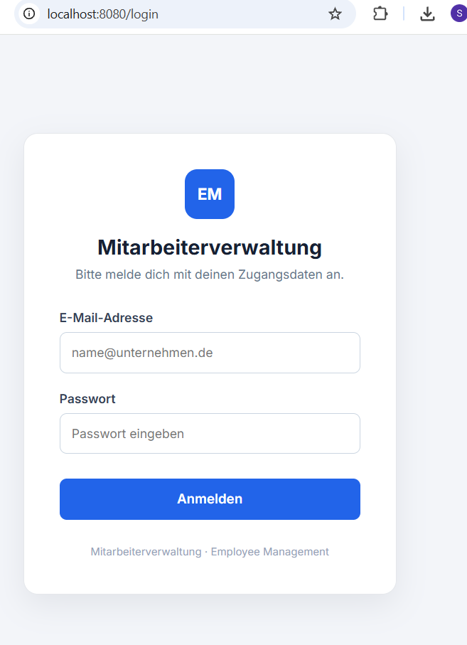
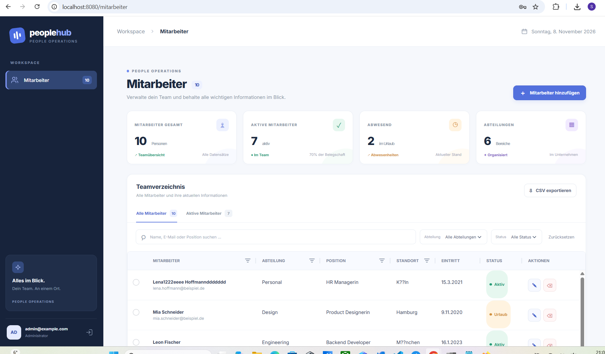
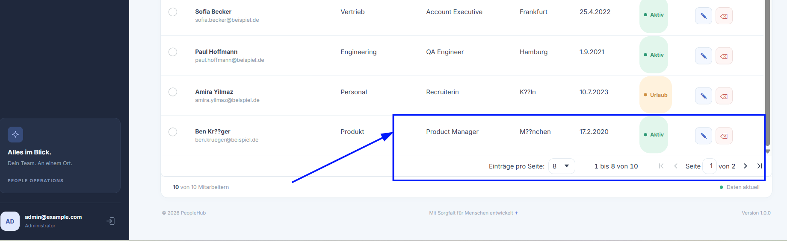
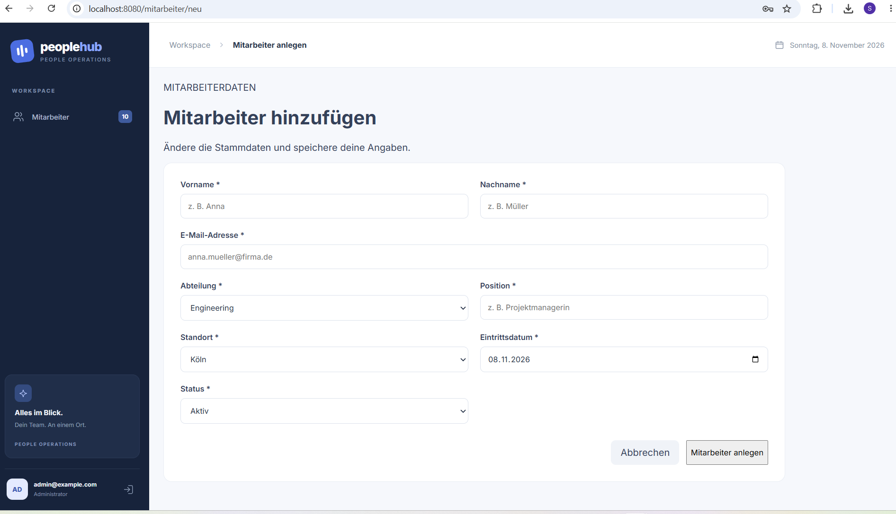
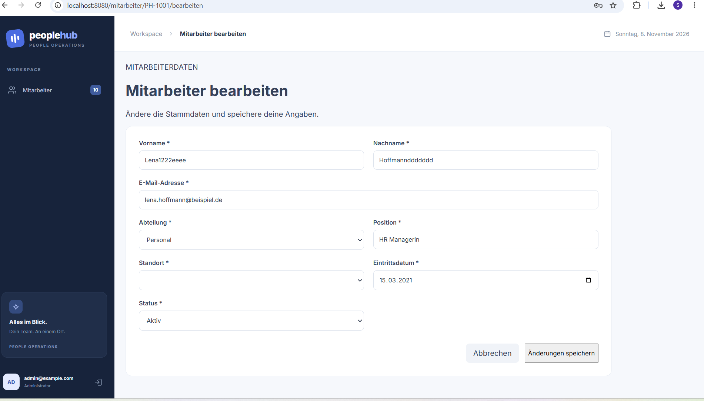
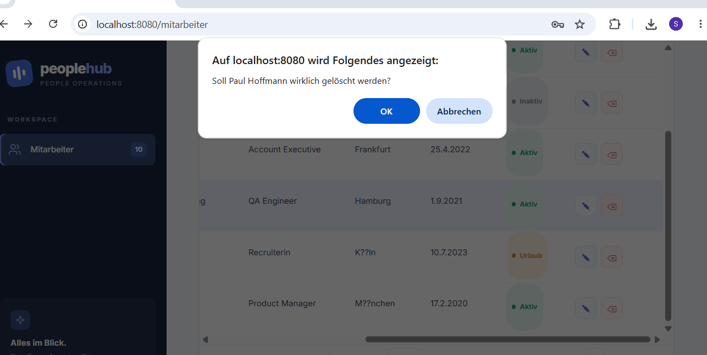
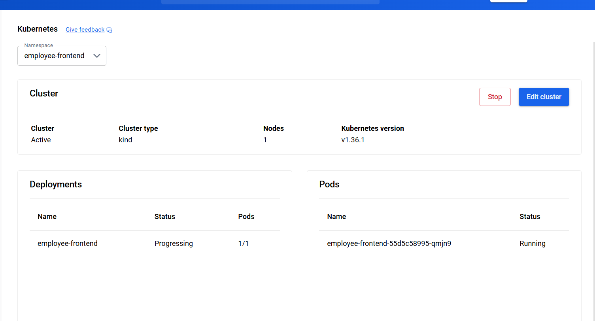
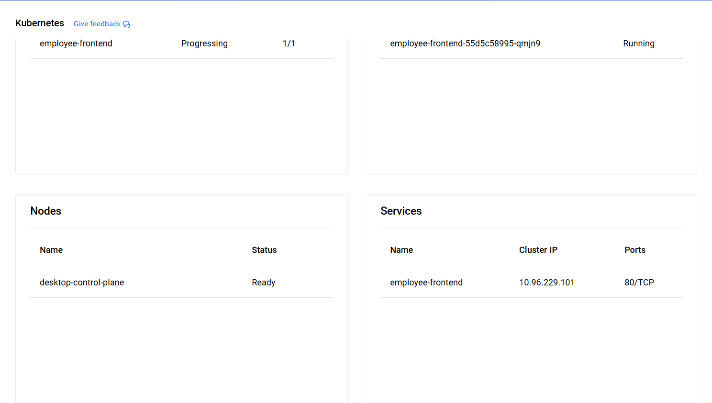
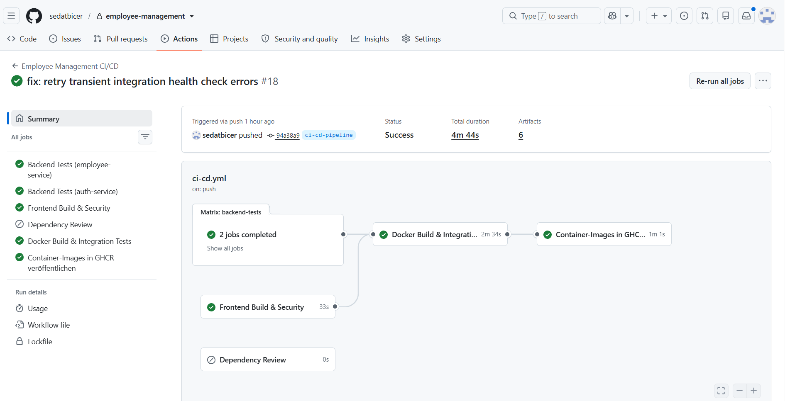
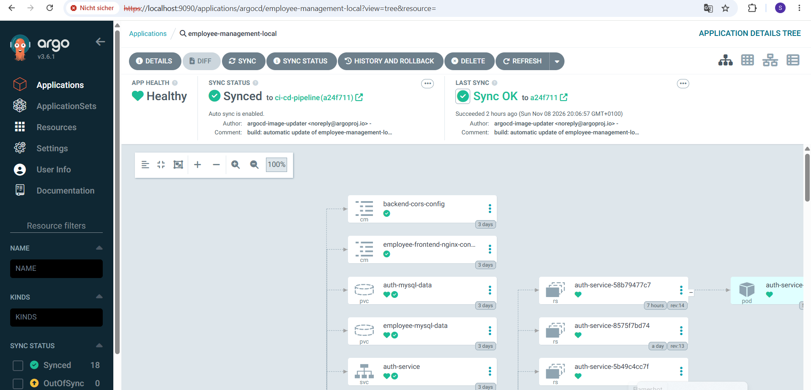

# Employee Management System

**Full-Stack-Anwendung mit Angular, Spring Boot, MySQL, Docker, Kubernetes und GitOps**

Ein Full-Stack-Projekt zur Verwaltung von Mitarbeitern mit rollenbasierter Authentifizierung, getrennten Backend-Services und einer containerisierten Infrastruktur.

Neben der Anwendungsentwicklung lag der Schwerpunkt auf dem Aufbau einer automatisierten CI/CD-Pipeline und einer GitOps-basierten Bereitstellung mit Kubernetes, Argo CD und Argo CD Image Updater.

---

## 1. Projektübersicht

Das Employee Management System ist eine webbasierte Anwendung zur Verwaltung von Mitarbeiterdaten.

Die Anwendung besteht aus einem Angular-Frontend, zwei eigenständigen Spring-Boot-Backend-Services und zwei separaten MySQL-Datenbanken.

Die Authentifizierung und die Mitarbeiterverwaltung sind als eigenständige Services umgesetzt.

Die Anwendung wurde zunächst mit Docker Compose betrieben und anschließend in eine lokale Kubernetes-Umgebung auf Basis von Docker Desktop überführt.

Darauf aufbauend wurde eine automatisierte CI/CD- und GitOps-Architektur implementiert.

---

## 2. Screenshots der Anwendung

### Login



### Mitarbeiterverwaltung





### Neuen Mitarbeiter anlegen



### Mitarbeiter bearbeiten



### Mitarbeiter löschen



---

## 3. Technologiestack

| Bereich | Technologie |
|---|---|
| Frontend | Angular, TypeScript |
| Backend | Java 21, Spring Boot |
| API-Architektur | REST API, HTTP/JSON |
| Persistenz | Spring Data JPA, Hibernate |
| Authentifizierung und Autorisierung | Spring Security, JWT |
| Datenbanken | MySQL 8.4 |
| Containerisierung | Docker, Docker Compose |
| Orchestrierung | Kubernetes |
| Lokale Kubernetes-Umgebung | Docker Desktop |
| Kubernetes-Konfiguration | Kustomize |
| CI/CD | GitHub Actions |
| Container Registry | GitHub Container Registry (GHCR) |
| GitOps | Argo CD |
| Image-Automatisierung | Argo CD Image Updater |
| Versionsverwaltung | Git, GitHub |

---

## 4. Systemarchitektur

Die Anwendung ist in drei logische Ebenen unterteilt.

| Ebene | Komponenten | Kubernetes Namespace |
|---|---|---|
| Frontend | Angular, Nginx | `employee-frontend` |
| Backend | Employee Service, Auth Service | `employee-backend` |
| Datenbank | Employee MySQL, Auth MySQL | `employee-database` |

### Architekturübersicht

```text
                         Benutzer
                            |
                            v
                       Webbrowser
                            |
                            v
                   Angular + Nginx
                  employee-frontend
                            |
                +-----------+-----------+
                |                       |
                v                       v
          Employee Service        Auth Service
            Spring Boot            Spring Boot
                |                       |
                v                       v
          Employee MySQL           Auth MySQL
           people_hub             people_hub_auth
```

Die Backend-Services kommunizieren jeweils mit ihrer zugeordneten MySQL-Datenbank.

Die Kommunikation innerhalb der Kubernetes-Umgebung erfolgt über interne Kubernetes Services.

### Trennung der Backend-Services

Die Anwendung verwendet zwei eigenständige Backend-Services:

**Employee Service**

- Verwaltung der Mitarbeiterdaten
- Zugriff auf die Employee-Datenbank
- Bereitstellung der entsprechenden REST-Schnittstellen

**Auth Service**

- Authentifizierung
- Autorisierung
- JWT-basierte Zugriffskontrolle
- Eigenständige Auth-Datenbank

---

## 5. Datenbanken und Datenmodell

Die Anwendung verwendet zwei getrennte MySQL-Datenbanken. Jeder Backend-Microservice verwaltet seine eigenen Daten und Tabellen.

Durch diese Trennung werden die Verantwortlichkeiten der beiden Services klar voneinander abgegrenzt.

### 5.1 Employee Service – Datenbank `people_hub`

Der Employee Service verwendet die Datenbank `people_hub`.

Die Mitarbeiterdaten werden in der Tabelle `employees` gespeichert.

**Tabelle: `employees`**

| Spalte | Datentyp | Eigenschaften | Beschreibung |
|---|---|---|---|
| `id` | VARCHAR(20) | Primary Key, NOT NULL | Eindeutige Mitarbeiter-ID |
| `first_name` | VARCHAR(255) | NOT NULL | Vorname |
| `last_name` | VARCHAR(255) | NOT NULL | Nachname |
| `email` | VARCHAR(255) | NOT NULL, UNIQUE | E-Mail-Adresse |
| `department` | VARCHAR(255) | NULL | Abteilung |
| `role` | VARCHAR(255) | NULL | Position oder Rolle |
| `location` | VARCHAR(255) | NULL | Standort |
| `start_date` | DATE | NULL | Eintrittsdatum |
| `status` | VARCHAR(255) | NOT NULL | Beschäftigungsstatus |

**Besonderheiten:**

- Die Mitarbeiter-ID wird durch die Anwendung vergeben.
- Die E-Mail-Adresse muss eindeutig sein.
- Vorname, Nachname, E-Mail-Adresse und Status sind Pflichtfelder.
- Das Eintrittsdatum wird als `LocalDate` verarbeitet.
- Die Datenbankstruktur wird über JPA/Hibernate abgebildet.

### 5.2 Auth Service – Datenbank `people_hub_auth`

Der Auth Service verwendet eine separate Datenbank mit dem Namen `people_hub_auth`.

Die Benutzerkonten werden in der Tabelle `app_users` gespeichert.

**Tabelle: `app_users`**

| Spalte | Datentyp | Eigenschaften | Beschreibung |
|---|---|---|---|
| `id` | BIGINT | Primary Key, AUTO_INCREMENT | Eindeutige Benutzer-ID |
| `email` | VARCHAR(255) | NOT NULL, UNIQUE | E-Mail-Adresse |
| `password_hash` | VARCHAR(255) | NOT NULL | Gehashter Passwortwert |
| `role` | VARCHAR(20) | NOT NULL | Benutzerrolle |
| `enabled` | BOOLEAN | NOT NULL | Benutzerkonto aktiviert |
| `created_at` | TIMESTAMP | NOT NULL | Zeitpunkt der Erstellung |

**Besonderheiten:**

- Die Benutzer-ID wird automatisch durch die Datenbank generiert.
- Die E-Mail-Adresse ist eindeutig.
- Passwörter werden nicht im Klartext gespeichert, sondern mit einem Password Encoder gehasht.
- Die E-Mail-Adresse wird vor dem Speichern normalisiert (Leerzeichen entfernen und Kleinschreibung).
- Das Erstellungsdatum wird automatisch beim Anlegen eines neuen Benutzers gesetzt.
- Der Auth Service kann beim Start einen initialen Administrator-Benutzer anlegen, sofern dieser noch nicht existiert.

### 5.3 Trennung der Datenbanken

Die beiden Datenbanken werden unabhängig voneinander durch ihre jeweiligen Microservices verwaltet.

| Service | Datenbank | Tabelle |
|---|---|---|
| Employee Service | `people_hub` | `employees` |
| Auth Service | `people_hub_auth` | `app_users` |

Zwischen den Tabellen besteht keine direkte relationale Fremdschlüsselbeziehung.

Die Trennung unterstützt die unabhängige Entwicklung und Verantwortlichkeit der Microservices. Jeder Service besitzt die Kontrolle über seine eigenen Daten und Datenbankstrukturen.

---

## 6. Kubernetes-Implementierung

Die Anwendung wurde von Docker Compose auf eine lokale Kubernetes-Umgebung mit Docker Desktop migriert.

Dabei wurde die Infrastruktur deklarativ mit Kubernetes-Manifests und Kustomize aufgebaut.

### Implementierte Kubernetes-Komponenten

- Drei getrennte Namespaces
- Deployments für die Anwendungskomponenten
- Kubernetes Services für die interne Kommunikation
- MySQL StatefulSets
- PersistentVolumeClaims für dauerhafte Datenspeicherung
- ConfigMaps für Konfigurationen
- Kubernetes Secrets für vertrauliche Werte
- Health Checks und Kubernetes Probes
- Resource Requests und Resource Limits
- NetworkPolicies
- Kustomize Base und Docker-Desktop-Overlay

### Screenshots

**Kubernetes Pod – Employee Frontend**



**Kubernetes Service – Employee Frontend**



---

## 7. CI/CD mit GitHub Actions

Für die automatisierte Integration und Erstellung der Container-Images wurde eine CI/CD-Pipeline mit GitHub Actions implementiert.

Die Pipeline wird bei Änderungen auf den konfigurierten Branches sowie bei Pull Requests gegen `main` ausgeführt.

### Pipeline-Ablauf

1. Automatisierte Backend-Tests für Employee Service und Auth Service.
2. Frontend-Build und Sicherheitsprüfung.
3. Dependency Review bei Pull Requests.
4. Docker-Build und Integrationstests mit Docker Compose.
5. Prüfung der Health-Endpunkte aller Anwendungskomponenten.
6. Erstellung und Veröffentlichung der Container-Images in GHCR.

### Verwendete Images

| Komponente | Image |
|---|---|
| Frontend | `ghcr.io/sedatbicer/employee-frontend` |
| Employee Service | `ghcr.io/sedatbicer/employee-service` |
| Auth Service | `ghcr.io/sedatbicer/auth-service` |

Die Images werden mit Commit-basierten SHA-Tags veröffentlicht. Dadurch ist jeder Container eindeutig einem Quellcode-Stand zugeordnet.

### Screenshot – Erfolgreiche CI/CD-Pipeline



---

## 8. GitOps mit Argo CD

Für die deklarative Verwaltung der Kubernetes-Ressourcen wurde Argo CD eingerichtet.

Argo CD überwacht das Git-Repository und synchronisiert den gewünschten Zustand der Anwendung mit dem tatsächlichen Zustand des Kubernetes-Clusters.

Es wurden zwei Argo CD Applications eingerichtet:

| Application | Aufgabe |
|---|---|
| `employee-management-local` | Bereitstellung der Anwendung |
| `employee-management-platform` | Verwaltung der Image-Updater- und Registry-Konfiguration |

Die Anwendungskonfiguration wird über Kustomize verwaltet.

Die Synchronisierung der lokalen Anwendung erfolgt automatisch über Argo CD Auto-Sync.

### Automatische Image-Aktualisierung

Zusätzlich wurde Argo CD Image Updater installiert und konfiguriert.

Die Komponente überwacht die drei Container-Images in GHCR und erkennt neue Images anhand des definierten SHA-Tag-Schemas.

Der Ablauf:

1. GitHub Actions veröffentlicht neue Container-Images.
2. Argo CD Image Updater erkennt die neuen Image-Tags.
3. Die aktualisierten Tags werden in die Kustomize-Konfiguration zurückgeschrieben.
4. Die Änderung wird automatisch in das Git-Repository übernommen.
5. Argo CD erkennt die Änderung und synchronisiert die Kubernetes-Ressourcen.
6. Kubernetes startet die Anwendung mit den neuen Container-Images.

Damit ist ein automatisierter Ablauf von der Codeänderung bis zur Aktualisierung der Kubernetes-Anwendung umgesetzt.

### Screenshot – Argo CD



---

## 9. Sicherheit und Zugangsdaten

Bei der Implementierung wurden verschiedene Sicherheitsmaßnahmen berücksichtigt.

- Getrennte Kubernetes Namespaces
- JWT-basierte Authentifizierung
- Kubernetes Secrets für vertrauliche Konfigurationswerte
- Separate Zugangsdaten für GHCR und Git Write-back
- Read-only Git-Zugriff für Argo CD
- Separater Registry-Zugriff für Image Updater
- NetworkPolicies zur Einschränkung der Netzwerkkommunikation
- Keine Zugangsdaten oder Tokens im Git-Repository

Die Registry-Zugriffe und Git-Zugangsdaten werden derzeit über manuell angelegte Kubernetes Secrets verwaltet.

Eine spätere Erweiterung um Sealed Secrets ist vorgesehen.

---

## 10. Projektstatus und nächste Schritte

### Implementiert und getestet

- Full-Stack-Anwendung mit Angular und Spring Boot
- Getrennte Employee- und Auth-Services
- Zwei eigenständige MySQL-Datenbanken
- Datenmodelle für Mitarbeiter und Benutzerkonten
- Eindeutige E-Mail-Adressen in beiden Datenbanken
- Passwort-Hashing im Auth Service
- Containerisierung mit Docker
- Lokale Kubernetes-Umgebung mit Docker Desktop
- Namespace-Trennung und persistenter Speicher
- GitHub Actions CI/CD-Pipeline
- Automatisierte Backend- und Frontend-Prüfungen
- Docker-Integrationstests
- Veröffentlichung der drei Container-Images in GHCR
- GitOps mit Argo CD
- Automatische Image-Aktualisierung mit Argo CD Image Updater
- Automatische Synchronisierung der Kubernetes-Konfiguration

### Geplante Erweiterungen

- Verschlüsselte Secret-Verwaltung mit Sealed Secrets
- Funktionale Negativtests der NetworkPolicies
- Übertragung der Infrastruktur auf AWS EKS
- AWS-spezifische Netzwerk- und Sicherheitskonfiguration
- Produktionsorientiertes Monitoring

**Hinweis:** AWS EKS befindet sich derzeit in der Vorbereitung und wurde noch nicht deployt oder funktional getestet.

---

## 11. Weiterführende Dokumentation

Eine ausführliche technische Dokumentation mit Architekturentscheidungen, Implementierungsdetails, Kubernetes-Konfigurationen und Betriebsanleitungen befindet sich im Ordner:

**[Technische Dokumentation – Kubernetes, CI/CD und GitOps](kubernetes/README.md)**

Dort werden unter anderem die lokale Kubernetes-Umgebung, die CI/CD-Pipeline, die GitOps-Architektur und die geplante AWS-EKS-Bereitstellung detailliert beschrieben.

---

## 12. Projektziel

Das Projekt verbindet die Entwicklung einer Full-Stack-Anwendung mit dem praktischen Aufbau einer containerisierten und automatisiert bereitgestellten Infrastruktur.

Der Schwerpunkt liegt auf der Kombination aus Softwareentwicklung, Containerisierung, Kubernetes-Orchestrierung, CI/CD und GitOps.

Die Implementierung zeigt den durchgängigen technischen Ablauf von der Entwicklung und automatisierten Prüfung des Quellcodes bis zur Bereitstellung und Aktualisierung der Anwendung in Kubernetes.